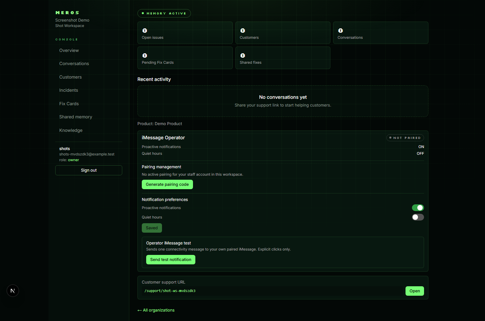
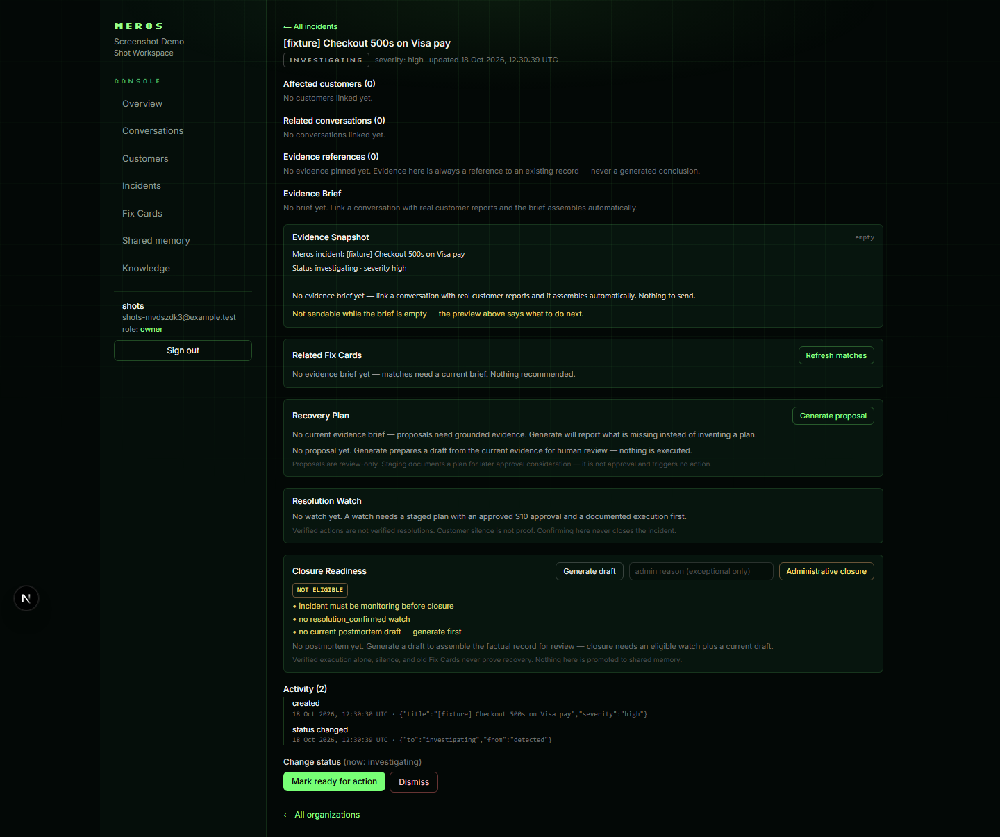
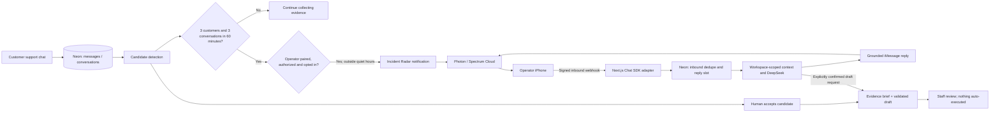

<div align="center">

# Meros Photon

### An incident-operations copilot that notices problems and reaches you in iMessage.

**Detect the pattern. Start the conversation. Ground the plan. Keep the human in control.**

[**Live product**](https://meros-photon.vercel.app) · [**Developer experience and engineering lessons**](docs/DEVELOPER_EXPERIENCE.md) · [**Original Meros memory demo**](https://usemeros.vercel.app)

     

</div>

> **What is this repository?** Meros Photon is the actively developed incident-operations application. It evolved from **Meros**, a separate Walrus/MemWal customer-support memory hackathon project. The two deployments and their evidence are distinct. The original experience lives at [usemeros.vercel.app](https://usemeros.vercel.app); the application described here lives at [meros-photon.vercel.app](https://meros-photon.vercel.app).

## The problem

Support tools help teams **see** tickets. But when three people report the same issue, somebody still needs to notice the pattern, identify what is actually known, alert the right teammate, and prepare the next safe step. Those handoffs lose context and waste time.

**Meros turns scattered support reports into a contextual iMessage conversation with the operator.** It does not independently fix production systems or communicate with customers without review.

## A real end-to-end walkthrough · October 24, 2026

In a controlled **NovaCart** production-system demonstration, three **synthetic test customers** separately reported that order tracking showed parcels as *delivered* even though nothing had arrived.

1. **Customers reported the issue** through the existing `/support/novacart-support` chat, using three separate authenticated identities and conversations.
2. **Incident Radar identified a new pattern.** The third report brought one *pending, unconfirmed* candidate to **3 distinct customers / 3 distinct conversations** inside a 60-minute window. It did not get merged into the separate Visa checkout incident.
3. **Meros proactively sent an iMessage.** An already-paired, opted-in NovaCart operator received a real unsolicited Radar alert on an iPhone. The outbound attempt was durably recorded and accepted by Photon; **the handset screenshot independently confirmed receipt**.
4. **The owner replied naturally.** “What's going on?” and “What do you think we should do?” yielded issue-specific context and suggestions, without command syntax or manually copying an ID.
5. **A human confirmed the candidate** in the staff console. Meros subsequently assembled a **source-backed evidence brief** separating customer observations, corroboration, hypotheses, and unknowns.
6. **The owner requested a plan in iMessage.** Meros identified the *tracking* incident rather than the unrelated Visa checkout incident, asked for a context-bound confirmation, and created **Recovery Plan Draft v1** after an explicit “Yes.”
7. **The existing draft was reused.** A later request returned the saved draft and one grounded recommendation with a complete staff-review link. It did **not** approve, execute, or send the plan to customers.

**Evidence boundary:** these were *synthetic customer reports exercising real deployed product flows*, not independently observed NovaCart customer failures or demonstrated parcel recovery. Handset receipt was observed, but Photon provider acceptance alone would not have proved it. The saved plan is a **draft**, not an implemented fix.

## Product surfaces

| Surface | What it does |
|---|---|
| Customer support chat | Persists customer reports and conversation context, with scoped memory and knowledge where available |
| Incident Radar | Evaluates persisted recurring-pattern candidates and notifies an eligible operator only after the 3×3 / 60-minute rule, opt-in, binding, staff, and quiet-hours gates |
| Photon iMessage copilot | Delivers alerts, resolves a natural-language question against authorized workspace evidence, and supports explicitly confirmed draft requests |
| Staff Incident Center | Reviews detected candidates, accepts or dismisses them, and manages confirmed incident lifecycles |
| Evidence briefs | Organizes source-cited facts, corroboration, contradictions, hypotheses, and unknowns; never treats guesses as confirmed causes |
| Recovery Plans | Creates validator-gated, versioned, evidence-referenced drafts; approval and any subsequent manual work remain separate human steps |
| Private / shared memory | Preserves customer context separately from staff-reviewed reusable fixes; historical Walrus proof and current relayer health must not be conflated |

**Existing product captures** (some were made with labeled fixtures; not claimed as captures from the October 24 handset test):





## Architecture



**Responsibilities, not just services:**

- **Photon / Spectrum Cloud and the official Chat SDK adapter** handle iMessage transport, provider integration and signed inbound webhook processing (`@photon-ai/chat-adapter-imessage`, `chat`). The endpoint is [`app/api/photon/imessage/route.ts`](app/api/photon/imessage/route.ts); adapter setup is in [`lib/photon/bot.ts`](lib/photon/bot.ts).
- **Next.js 15 App Router** serves the product and authenticated APIs. The webhook uses `after()` for background processing after acknowledgment.
- **Neon Postgres** is the durable source of truth for identities, pairings, thread history, reports, candidates, incidents, briefs, plans, and outbound attempts. Chat SDK process-local state is **not** the durable idempotency boundary.
- **Better Auth and workspace staff checks** gate operator access. Phone sender identity is mapped to an active binding and revalidated against staff membership.
- **DeepSeek Flash** is the verified current production primary AI provider (`AI_PROVIDER=deepseek`, `DEEPSEEK_MODEL=deepseek-flash`); Gemini integrations remain in the codebase but are **not** an automatic fallback when DeepSeek is explicitly selected.
- **Walrus / MemWal** serves the memory architecture. A public relayer health probe does **not** prove authenticated memory writes or successful private/shared recall in the current deployment.

### Receiving an iMessage

The actual serverless handler follows Photon's recommended signed-webhook pattern:

```ts
// app/api/photon/imessage/route.ts (abridged)
import { after } from "next/server";

export async function POST(request: Request): Promise<Response> {
  const { getBot } = await import("@/lib/photon/bot");
  return getBot().webhooks.imessage(request, {
    waitUntil: (task) => after(() => task),
  });
}
```

*The real route additionally handles missing credentials and error responses.* Signature validation belongs to the official Photon adapter, **not** to a bypassable custom parser. A registered HTTPS webhook points to:

```text
https://meros-photon.vercel.app/api/photon/imessage
```

Photon's [official adapter documentation](https://github.com/photon-hq/vercel-chat-adapter-imessage) describes its Spectrum Cloud and webhook modes. This project uses Cloud mode, **not** an on-device Mac gateway.

### At-least-once delivery without duplicate side effects

Spectrum webhook retries mean delivery should be treated as at least once. Meros records incoming messages in [`lib/photon/history.ts`](lib/photon/history.ts), deduping on provider message ID. A unique `reply_to_id` permits one outbound reply slot per inbound message. Radar alerts use a separate per-**candidate + operator** idempotency key. A failed proactive provider attempt is recorded and is not blindly resent with a new key.

**Important:** a `sent` row and provider message ID prove **provider acceptance**, not Apple handset receipt. For the October 24 test, the owner separately observed and captured the unsolicited message on their physical iPhone.

### Conversational control is not autonomous execution

The model may classify questions and phrase **validated, scoped facts**, but cannot decide that a vague statement authorizes a write. Plan draft creation requires a deterministic explicit request or a **newest valid, incident-bound YES prompt**. The record is re-resolved against current workspace data before drafting. An unknown or ambiguous incident prompts clarification rather than silently selecting one from old history.

Proposals are checked against authorized evidence references. **No iMessage approval, automated recovery execution, customer broadcast, or verified resolution is claimed.**

## Run locally

**Requirements:** Node.js 20+, npm, a dedicated Neon database, and the credentials for the services you intend to test. You can run/build without Photon credentials, but real iMessage tests require an existing Spectrum Cloud project and an HTTPS webhook accessible to Photon.

```bash
git clone https://github.com/kaelah971/meros-photon.git
cd meros-photon
npm install
cp .env.example .env.local
```

Configure the relevant **server-only** values in `.env.local` (never commit it):

```dotenv
DATABASE_URL=...
BETTER_AUTH_URL=http://localhost:3002
BETTER_AUTH_SECRET=...

AI_PROVIDER=deepseek
DEEPSEEK_API_KEY=...
DEEPSEEK_MODEL=deepseek-flash

# Only when using Photon / Spectrum Cloud
IMESSAGE_PROJECT_ID=...
IMESSAGE_PROJECT_SECRET=...
IMESSAGE_WEBHOOK_SECRET=...

# Only when testing Walrus memory
MEMWAL_PRIVATE_KEY=...
MEMWAL_ACCOUNT_ID=...
MEMWAL_SERVER_URL=https://relayer.memory.walrus.xyz
```

> `deepseek-flash` was verified in the project's provider account on October 24, 2026; model availability is account-dependent. Check the available model list instead of assuming a permanent provider ID. The tracked `.env.example` also contains historical default comments; explicitly selecting the desired model avoids ambiguity.

**Use a non-production database** for migrations and local testing. From the repository root:

```bash
npm run db:migrate
npm run dev -- -p 3002
```

Open `http://localhost:3002`, matching `BETTER_AUTH_URL`.

```bash
npm run typecheck
npm test
npm run build
```

Read-only deployment diagnostics: `GET /api/health` reports configured providers, the active AI provider, Neon reachability, and a **public** Walrus relayer probe. It does not run a real authenticated Walrus memory write.

### Reproducing the actual Photon integration

1. Create/configure a Spectrum Cloud project and register the public HTTPS webhook above (use your own deployed origin).
2. Configure the project ID, project secret, and *separate* per-webhook signing secret securely.
3. Sign in to Meros, create an organization/workspace, and ensure the operator is a staff member.
4. Complete the product's operator pairing flow using an explicitly authorized phone, then enable proactive notifications and **separately** enable Incident Radar; quiet hours still apply.
5. Generate controlled support reports through real customer sessions. Three distinct customers and conversations within 60 minutes are required for a qualifying new candidate. **Do not test with real customers or replay production webhooks.**
6. Confirm the provider accepted **one** Radar send and separately verify receipt on the physical handset. Investigate naturally, accept the candidate through the staff UI, and request a draft only after reviewing its evidence.
7. Clean up test identities and notification settings with authorization. Do not present synthetic reports as live customer failures.

The repository includes [`docs/radar-demo-scenario.md`](docs/radar-demo-scenario.md) and [`docs/plan-copilot-demo.md`](docs/plan-copilot-demo.md) for controlled tests. Those documents describe isolated fixtures; the October 24 demonstration instead used clearly labeled synthetic customers in the **existing NovaCart workspace**, with the retained test records clearly identified.

## Results, constraints, and what remains unproven

| Item | Evidence status (Oct 24, 2026) |
|---|---|
| Incident Radar grouped 3 × 3 separate reports | **Live verified** in the NovaCart controlled test |
| One unsolicited alert accepted by Photon | **Live verified** with durable outbound ID |
| Unsolicited alert seen on iPhone | **Handset verified** by owner screenshot |
| Contextual iMessage conversation | **Handset verified**; one inbound delivery exhibited a long upstream delay |
| Recovery plan Draft v1 persisted and reused | **Live verified** against a saved incident plan row |
| Approval / execution / customer recovery | **Not demonstrated and not automated** |
| Walrus public relay health | **Read-only public probe only**; authenticated writes and current end-to-end recall are **not proven by that probe** |
| Production Git auto-deploy | **Not connected** during these releases; reviewed commits were pushed and clean Vercel CLI deploys performed separately |

For concrete failure investigations, regression tests, resolved issues, unresolved limits and DX recommendations, see **[Developer Experience Report](docs/DEVELOPER_EXPERIENCE.md)**.

## Where to read the code

- [`lib/radar.ts`](lib/radar.ts) — eligibility, sanitized alerts, timing gates, idempotency key.
- [`lib/photon/bot.ts`](lib/photon/bot.ts), [`lib/photon/operator.ts`](lib/photon/operator.ts), [`lib/photon/history.ts`](lib/photon/history.ts) — adapter, auth/binding, persistence and reply control.
- [`lib/photon/converse.ts`](lib/photon/converse.ts), [`lib/photon/plan-copilot.ts`](lib/photon/plan-copilot.ts) — grounded chat, topic selection, confirmation and draft handling.
- [`lib/evidence-brief.ts`](lib/evidence-brief.ts), [`lib/recovery-plans.ts`](lib/recovery-plans.ts) — evidence construction and recovery-plan validation.
- [`app/api/health/route.ts`](app/api/health/route.ts) — honest deployment health.

## Origins and credits

Meros began as a **Walrus Session 8** hackathon build: “Solve it once. Remember it for everyone.” That earlier project introduced isolated private customer memory, staff-reviewed shared Fix Cards, and an Alice → staff → Bob proof flow; the original demo reported **38 Walrus Mainnet memory blobs**. Those historical claims refer to the original hackathon experience, **not** to an authenticated write/recall test of today's Meros Photon production deployment. The new application preserves that product lineage while demonstrating an additional Photon-native operations experience.

Built as an applied developer project exploring **agentic workflows, trustworthy human approval, iMessage transport, and developer experience**.

## License

**No license file is currently present.** Public repository visibility does not imply an open-source license or grant reuse rights. Add an explicit `LICENSE` if broad reuse is intended.
